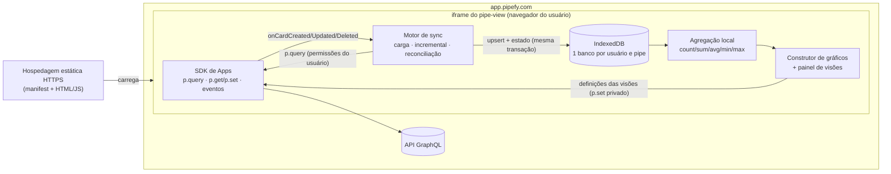
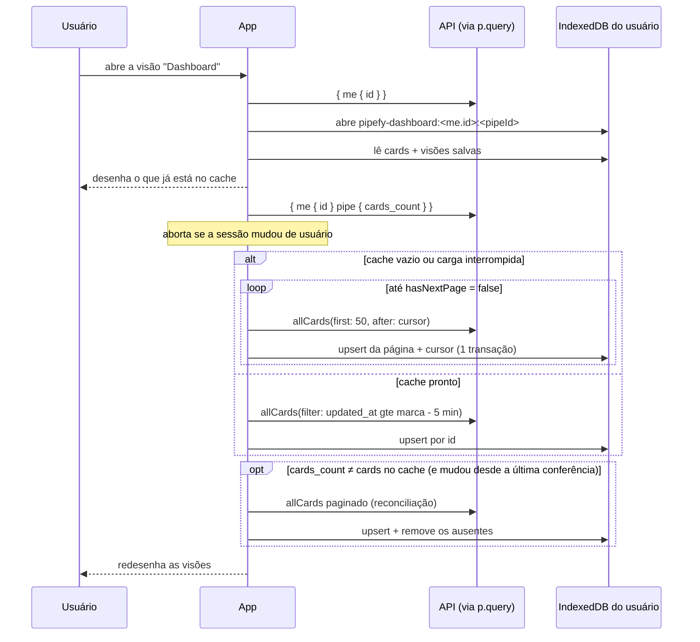

# Arquitetura

App de dashboard que roda **dentro da Pipefy**, como uma visão do pipe (`pipe-view`), e permite montar gráficos sobre um pipe de ~20 mil cards sem buscar tudo a cada abertura.

As decisões, com alternativas e motivos, estão em [decisoes.md](decisoes.md). A leitura da documentação do SDK está em [pesquisa-sdk-apps.md](pesquisa-sdk-apps.md).

---

## Por que um app, se o pipe já tem Reports e Dashboards?

Comparação feita em 20/11/2026: abri o construtor de Dashboards e a aba Reports do pipe 307434671, sem salvar nada, e li a Central de Ajuda ([What are dashboards](https://help.pipefy.com/en/articles/5610976-what-are-dashboards), [How to create dashboards](https://help.pipefy.com/en/articles/6047064-how-to-create-dashboards), [Numeric features](https://help.pipefy.com/en/articles/8451892-numeric-features-transform-data-in-results-with-pipefy)).

**O que o nativo já faz bem, e o app não tenta superar:**

- No pipe, Valor Total é um campo `number` e Data Limite é um campo `date` (conferido com `pipe { start_form_fields { id type } }`). O Dashboard nativo soma, tira média, mínimo, máximo e total acumulado do Valor Total, e usa a Data Limite como eixo de tempo. O texto (`"1285947.3"`, `"27/02/2027"`) é só o formato do JSON da API, e por isso o app converte na entrada.
- Tem 8 formatos (área, barra, calendário, linha, número, pizza, dispersão, tabela). O app tem 4.
- Clicar num ponto do gráfico abre os cards por trás dele.
- Os dados são calculados no servidor, em tempo real, sem carga inicial e sem hospedagem.
- Reports são tabelas com filtros, fórmulas de soma, média, mínimo e máximo, e exportação.

**O que o app faz e o nativo não faz, nas mesmas condições:**

| Necessidade | Dashboard nativo (verificado) | Este app |
| --- | --- | --- |
| Agrupar a empresa sem o sufixo ("Aperture Holding" e "Aperture ME" → "Aperture") | A dimensão é o campo como está: na prévia, "Aperture Holding" e "Aperture ME" saem em linhas separadas. Juntar exigiria criar um campo novo e preenchê-lo nos 20 mil cards, mudando o pipe; as fórmulas de automação documentadas são só numéricas | Dimensões derivadas `Empresa (sem sufixo)` e `Domínio do e-mail`, calculadas no sync, sem tocar no pipe |
| "Vencido / vence em até 7 dias / a vencer" em relação a hoje | Os períodos prontos olham para trás (hoje, últimos 7 dias, mês passado...). Não há "próximos 7 dias". O filtro por data tem "antes de" e "depois de" uma data; não verifiquei se aceita "hoje" como valor relativo | Dimensão `Situação de vencimento`, recalculada a cada dia, com a janela futura |
| Cada usuário monta as próprias visões | Os dashboards são do pipe e compartilhados com admins e membros. Na versão Basic, todos os admins e membros veem todos; permissão por dashboard é do Dashboards Pro | Visões salvas no escopo privado do usuário, pelo SDK |
| Montar gráficos sem licença extra | Segundo a Central de Ajuda, dashboards personalizáveis são do **Dashboards Pro** (US$ 2,99 por usuário por mês, nos planos Business, Enterprise e Unlimited). O Basic traz os dashboards padrão | Não depende do Dashboards Pro. Não verifiquei em quais planos os Apps estão disponíveis |
| Regra de negócio própria | Limitada às medidas, dimensões e filtros da tela | É código: uma dimensão, métrica ou regra nova é uma função testada |

O app não substitui os recursos nativos. Ele cobre o que exige **dados derivados, regras relativas a hoje e visões pessoais**, sem alterar o pipe. O cache local com sync incremental não é vantagem sobre o nativo, que calcula no servidor. É o que permite a um app, que só tem a API, abrir rápido sem baixar 20 mil cards toda vez.

**Não verificado:** se o Dashboard nativo filtra os números pelos cards que cada usuário enxerga. No app, esse isolamento vem do `p.query`, que roda com as permissões de quem está logado.

--- | --- | --- |
| Agrupar a empresa sem o sufixo societário ("Acme Holding", "Acme Group" → "Acme") | Agrupa pelo texto do campo | Dimensão derivada `Empresa (sem sufixo)` e `Domínio do e-mail` |
| Valor Total guardado como texto, data no formato DD/MM/AAAA | Depende do tipo do campo | Conversão para número e data ISO na entrada, uma vez só |
| "Vencidos vs. a vencer" em relação a hoje | Exige filtro manual | Dimensão `Situação de vencimento`, recalculada no dia |
| Várias visões montadas pelo próprio usuário, salvas só para ele | Relatórios compartilhados no pipe | Visões salvas por usuário, no escopo privado do SDK |
| Abrir rápido sem consultar a API inteira | — | Cache local por usuário com sync incremental |

O app não substitui os relatórios nativos. Ele cobre o que exige dados derivados e uma visão pessoal.

---

## Visão geral

Não há backend. Todas as chamadas à API passam pelo `p.query` do SDK, que roda com as permissões de quem está usando o app. É isso que garante que cada usuário só sincroniza os cards que pode ver.

### Módulos

| Pasta | Responsabilidade |
| --- | --- |
| `src/domain` | Card normalizado e parser: mapeia por `field.id`, converte número e data e calcula as dimensões derivadas |
| `src/sync` | Cliente GraphQL sobre o `p.query` (erros e retry), queries do `allCards`, marca d'água e motor de sync |
| `src/cache` | Contrato do cache e implementação em IndexedDB |
| `src/analytics` | Agregação (group by) com limite de grupos e "Outros" |
| `src/charts` | Definições de gráficos (validação e persistência no `p.set`) e renderização com Chart.js |
| `src/ui`, `src/app` | Tela e orquestração: identifica o usuário, abre o cache, sincroniza e redesenha |
| `src/pipefy` | Tipos do SDK e um SDK falso para desenvolver fora da Pipefy |

O motor de sync depende de duas interfaces, `PipefyApi` e `CardStore`, e não do SDK nem do IndexedDB. Por isso os testes rodam com um pipe falso e um store em memória.

---

## Fluxo ao abrir o app

### Carga inicial

- Pagina o `allCards` com 50 cards por página, o máximo aceito.
- Cada página é gravada **na mesma transação** que o cursor. Se a aba fechar ou a rede cair, a próxima abertura retoma do último cursor salvo, sem baixar de novo o que já está no cache.
- Card com dado inválido (sem id ou com `updated_at` ilegível) é contado e ignorado, sem derrubar o sync.

### Incremental

- Filtra `updated_at gte <marca d'água − 5 min>` e faz upsert por id.
- A marca d'água é o **início do último sync completo**. Tudo o que mudou antes desse instante já foi lido; o que mudou durante ou depois tem `updated_at` posterior e entra no próximo sync (ver D4 em [decisoes.md](decisoes.md)).
- Se o incremental cair no meio, a marca não avança e o próximo sync repete a janela.

### Exclusões

- **Com o app aberto:** o evento `onCardDeleted` do `pipe-view` remove o card do cache na hora.
- **Com o app fechado:** a cada sync, o app compara o `cards_count` do pipe com o cache. Se forem diferentes e o `cards_count` tiver mudado desde a última conferência, pagina o pipe de novo, faz upsert e remove os ausentes.

### Eventos ao vivo e concorrência

- `onCardCreated` e `onCardUpdated` agendam um incremental 2 s depois, juntando rajadas de eventos.
- Um trabalho por vez em cada aba (sync ou limpeza do cache). Um sync pedido durante outro roda logo depois que o primeiro termina, então nenhum evento se perde.
- Entre abas, o Web Locks serializa os syncs do mesmo usuário e pipe. A segunda aba espera a primeira e depois faz um incremental barato, que já recarrega o cache.
- O `onCardDeleted` remove o card sem tocar no estado do sync, para não sobrescrever o que um sync em andamento gravou.

### Troca de sessão

Todo sync relê o `me.id` na mesma chamada do `cards_count`, sem custo extra. Se alguém sair da conta e entrar com outro usuário em outra aba, o dashboard aberto para de sincronizar antes de gravar qualquer coisa no cache do usuário anterior e pede para recarregar a página.

---

## Custo em chamadas à API

Valores para o pipe do case (20 mil cards, 50 por página):

| Situação | Chamadas |
| --- | --- |
| Identificar o usuário (`me`) | 1 por abertura |
| Carga inicial completa | 1 (`me` + `cards_count`) + 400 páginas = **401** |
| Sync sem mudanças | 1 (`me` + `cards_count`) + 1 (incremental vazio) = **2** |
| Sync com *k* cards alterados (*k* ≥ 1) | 1 + ⌈*k*/50⌉, +1 se as contagens divergirem (confirmação antes de reconciliar) |
| Reconciliação (só quando o `cards_count` muda) | +400 |

Uma abertura comum custa **3 chamadas**, contra cerca de 400 se o app baixasse tudo a cada vez. O app mostra, depois de cada sync, quantas chamadas ele fez.

### Medido dentro da Pipefy (19/11/2026, pipe 307434671)

| Situação | Resultado |
| --- | --- |
| Carga inicial | **401 chamadas**, 20.000 cards gravados, cerca de **2 min e 20 s** (~0,35 s por página de 50 cards) |
| "Sincronizar agora" sem mudanças | **2 chamadas** |
| Recarregar a página | 20.000 cards lidos do cache e visões restauradas, mais 1 sync de 2 chamadas |

Também ficou confirmado na prática:
- o `PipefyApp.init()`/`render` e o `p.query` funcionam no iframe;
- o IndexedDB persiste dentro do iframe da Pipefy;
- o `p.set`/`p.get` privado guarda as visões.

---

## Isolamento por usuário

1. O usuário é o `me.id` devolvido pela própria Pipefy, e não um valor que o app recebe pela URL.
2. Cada usuário tem um **banco IndexedDB próprio** (`pipefy-dashboard:<me.id>:<pipeId>`). Não existe query que leia dados de dois usuários.
3. O conteúdo do cache vem do `p.query` com as permissões **desse** usuário. Um usuário com menos acesso baixa menos cards.
4. As visões ficam em `p.set('pipe', 'private', ...)`, visíveis só para o próprio usuário.

---

## Limitações conhecidas

- **A primeira carga é lenta:** são cerca de 400 chamadas em sequência. Ela é retomável e mostra o progresso, mas a primeira abertura de cada usuário em cada navegador paga esse custo. O tempo real precisa ser medido na org.
- **Cota da API** (Central de Ajuda, lida em 19/11/2026):
  - **Por período:** 500 requisições a cada 30 s; quem passa disso fica 5 min sem acesso à API. A carga é sequencial e fica bem abaixo desse ritmo.
  - **Por mês, conforme o plano:** Starter 20, Business 500, Enterprise 10.000, Unlimited sob medida. Num plano Business, uma única carga completa gastaria quase o mês todo; é o argumento mais forte para o cache e o sync incremental.
  - **Na org do case:** a query `apiUsageStats` (só admin) devolveu `limit: null`, sem limite configurado, e `Counter: 0` em novembro, mesmo depois de chamadas feitas pelo GraphiQL. Pelo jeito, chamadas feitas com a sessão do navegador não entram nesse contador. É uma inferência, não está documentado; resta confirmar se as chamadas do SDK (`p.query`) contam.
  - **Estouro:** é repetido com backoff exponencial, até 4 vezes. Se ainda falhar, o progresso fica salvo e o sync pode ser retomado.
- **Relógio do navegador:** a marca d'água usa o relógio local com margem de 5 min. Um relógio adiantado além disso pode perder alterações.
- **Mudança de visibilidade:** se o usuário passar a enxergar cards antigos ou perder acesso a eles sem que o `cards_count` mude, o app não detecta. "Limpar cache local" força uma carga completa.
- **Criação + exclusão no mesmo intervalo** mantém a contagem e esconde a exclusão até o próximo `cards_count` diferente. Com o app aberto, o evento `onCardDeleted` cobre esse caso.
- **Mesmo navegador, vários usuários:** os bancos são separados por usuário, mas ficam no mesmo disco. O isolamento é do app, não do sistema operacional.
- **Armazenamento do navegador:** o IndexedDB de um iframe de terceiro fica particionado pelo site de topo. O Safari pode apagar esses dados depois de alguns dias sem uso, e aí acontece uma nova carga completa.
- **Cursor recusado:** se a API passar a recusar o cursor salvo de uma carga interrompida, a retomada falha sempre com o mesmo erro. "Limpar cache local" recomeça do zero.
- **Semântica do `cards_count`:** foi confirmado que ele conta os cards da fase concluída (deu 20.000, todos em "Concluded"). Não foi testado se ele respeita as permissões de quem consulta. Se não respeitar, um usuário com visão parcial faz uma reconciliação (~400 chamadas) a cada mudança no total do pipe.
- **Eventos do pipe-view:** segundo a documentação, o `onCardUpdated` cobre só mudanças de vencimento. As demais edições chegam pelo incremental, quando o app abre ou quando o usuário clica em "Sincronizar agora".

---

## Boas práticas aplicadas

- **Testes primeiro nos pontos críticos:** parser com ordem variável de campos e campos vazios, marca d'água, retomada da carga, reconciliação, isolamento do cache e validação das visões salvas. O CI roda typecheck, testes e build.
- **Normalização na entrada:** número, data ISO e dimensões derivadas são calculados uma vez, no sync.
- **Gravação atômica:** cards e estado do sync na mesma transação, então o cursor nunca fica à frente dos dados.
- **Erros da API tratados como dados:** o `p.query` nunca rejeita a promise. O cliente verifica `errors` (array ou `Error`, mesmo com HTTP 200), trata resposta parcial como erro e só repete o que é retentável.
- **Sem injeção na query:** valores dinâmicos entram escapados com `JSON.stringify`, e o `pipeId` é validado como numérico.
- **Sem XSS:** todo texto vindo dos cards entra no DOM por `textContent`. Os gráficos são desenhados em `<canvas>`.
- **Dados salvos tratados como não confiáveis:** as definições lidas do `p.get` são validadas item a item.
- **Sem segredos:** o app não guarda token nenhum; o SDK cuida da autenticação.
- **Acessibilidade:** cada gráfico tem uma tabela "Ver dados" com os mesmos números. As cores categóricas seguem uma paleta validada para daltonismo, em ordem fixa, com tema claro e escuro.
